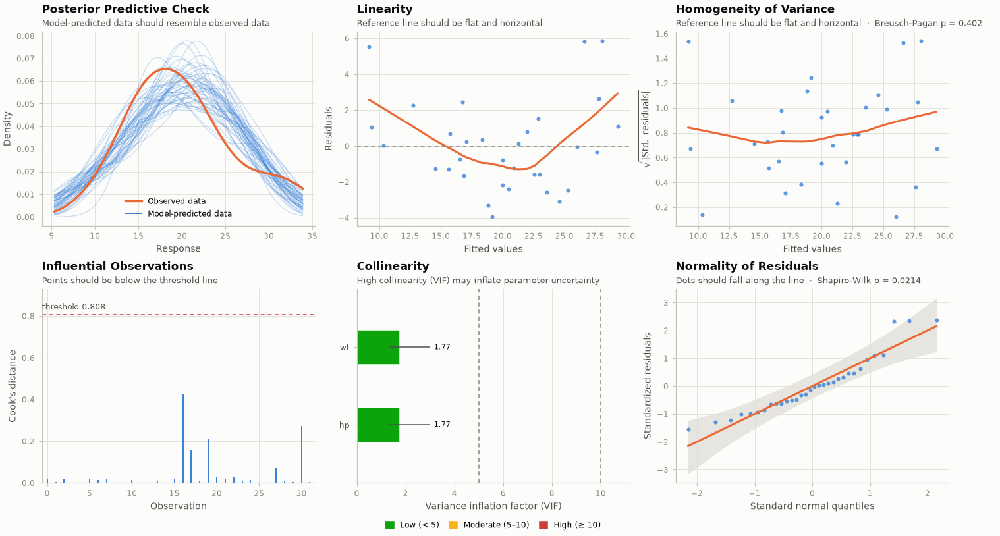

# checkmodel

**One-call diagnostics for statistical models in Python**, ported from R's
[`performance`](https://easystats.github.io/performance/) package.

```bash
pip install checkmodel
```

```python
from checkmodel import check_model

report = check_model(fit)   # a statsmodels, scikit-learn, PyMC or bambi model
report.plot()
```

`check_model()` works out what kind of model it was given and runs the
checks that make sense for it. A linear regression gets normality,
homoscedasticity, multicollinearity and influential observations, plus
autocorrelation for time series. A logistic regression gets binned residuals, a count model
overdispersion and zero-inflation, and a mixed model singularity and
random-effect normality. Every model starts with a posterior predictive check.



## Where to go next

- **[Getting started](getting-started.md)**: install, check a model, read the
  results, compare models.
- **[Examples](examples/quickstart.ipynb)**: worked notebooks for linear,
  logistic, mixed and Bayesian models, and a guide for R users.
- **[Supported models](supported-models.md)**: which check works on which model.
- **[API reference](api-reference.md)**: every function and result type.
- **[Comparison with R](comparison-with-r.md)**: function-by-function mapping
  and the few deliberate differences.

## Tested against R

Every statistic is compared with R (`performance` 0.18.2, `lme4`, `lmtest`,
`car`, `MASS`, `rstanarm`, `loo` and `posterior`) on 27 reference models, to
a tolerance of 1e-4. The Bayesian statistics are checked on the same
posterior draws as R.
